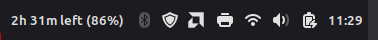

# Work Time Left

A small Cinnamon panel applet that tells you how much of your workday is left.



I wanted something quieter than a full time tracker: just a glance at the panel to see how long until I'm done. Before your shift it counts down to the start, during the shift it shows the time remaining, and hovering over it shows how long you've worked so far.

## Features

- Start and end times in 24-hour `HH:MM`
- Pick which days you work; off days stay out of the way
- Overnight shifts (for example 22:00 to 06:00)
- Optional percentage of the day completed
- Tooltip with time worked so far
- Updates every minute, settings apply live

Works on Cinnamon 5.4 through 6.6. Tested on Linux Mint with Cinnamon 6.6.

## Install

### From Cinnamon Spices

Once it's accepted on [Cinnamon Spices](https://cinnamon-spices.linuxmint.com/applets), open **System Settings → Applets → Download**, search for *Work Time Left*, install it, then add it to your panel from the **Manage** tab.

### Manually

1. Download `WorkTimeLeft-1.0.0-cinnamon-applet.zip` from the [latest release](https://github.com/CimTS/worktimeleft/releases/latest).
2. Unzip it into your applets folder:
   ```sh
   unzip WorkTimeLeft-1.0.0-cinnamon-applet.zip -d ~/.local/share/cinnamon/applets/
   ```
3. Right-click the panel, choose **Applets**, and add *Work Time Left*.

Or from a clone of this repo:

```sh
cp -r "worktimeleft@CimTS/files/worktimeleft@CimTS" ~/.local/share/cinnamon/applets/
```

If it doesn't show up right away, restart Cinnamon with `Alt+F2`, type `r`, and press Enter.

## Settings

Right-click the applet and choose **Configure...**

| Setting | Default | What it does |
| --- | --- | --- |
| Workday start | `09:00` | When your shift starts (24-hour) |
| Workday end | `17:00` | When your shift ends (24-hour) |
| Show percent | off | Adds the percentage of the day completed |
| Workdays | Mon–Fri | Which days count as work days |

## Overnight shifts

If the end time is earlier than the start time, the shift is treated as running past midnight. With a start of `22:00` and an end of `06:00`, the countdown runs through the night and the shift belongs to the day it started on, so a Friday night shift ending Saturday morning counts as Friday.

## Building

There's nothing to compile. The applet is plain GJS, and a release is just the applet folder zipped:

```sh
cd "worktimeleft@CimTS/files"
zip -r ../../WorkTimeLeft-1.0.0-cinnamon-applet.zip "worktimeleft@CimTS"
```

To watch for errors while you're hacking on it, open Looking Glass (`Alt+F2`, `lg`) and check the Log tab, or run `journalctl --user -f` / `tail -f ~/.xsession-errors`.

## Translations

The template is at `worktimeleft@CimTS/files/worktimeleft@CimTS/po/worktimeleft@CimTS.pot`. To add a language:

```sh
cd "worktimeleft@CimTS/files/worktimeleft@CimTS/po"
msginit -i worktimeleft@CimTS.pot -l de -o de.po
```

Translate the strings, then open a pull request. To try a translation locally, `cinnamon-xlet-makepot -i` from the applet folder installs the compiled files. Once the applet is on Spices, translations can also go through the Spices repo as usual.

## Contributing

Bug reports and ideas are welcome in [Issues](https://github.com/CimTS/worktimeleft/issues). Please include your Cinnamon version and your start/end settings if something looks off.

## Support

If it saves you a few glances at the clock and you'd like to say thanks, you can buy me a coffee on Ko-fi. Totally optional.

[](https://ko-fi.com/J0Q728QLHG)

## License

MIT. See [LICENSE](LICENSE).
